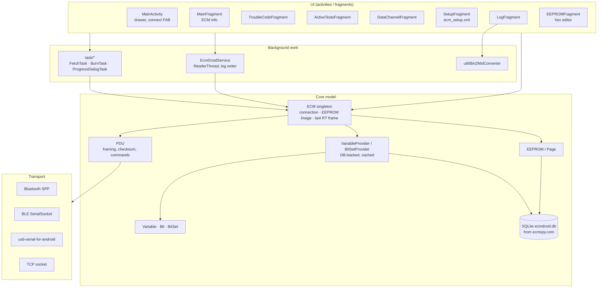
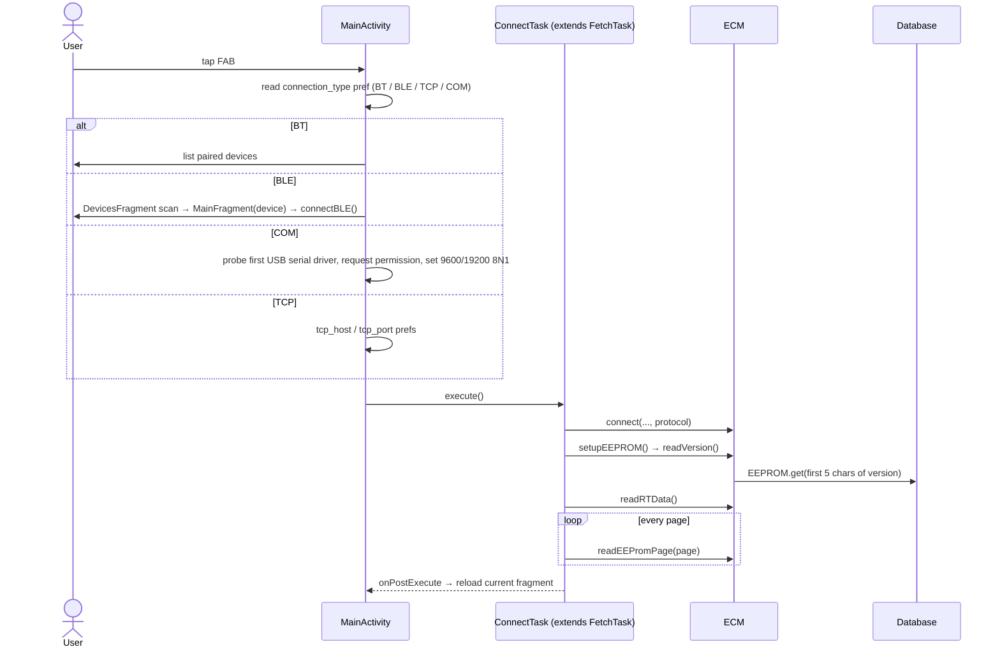

# Architecture

EcmDroid is a single-module Android application (`:app`, package
`org.ecmdroid`) written in Java. It has no backend and talks only to the ECM
through a serial-style link.

| Item            | Value                                                                                              |
|-----------------|----------------------------------------------------------------------------------------------------|
| Language        | Java, source/target 1.8                                                                            |
| Android         | `minSdk 26` (Android 8), `targetSdk 33`, `compileSdk 34`                                           |
| Build           | Gradle 9.4.1 (wrapper), Android Gradle Plugin 9.2.1, Kotlin DSL, version catalog `gradle/libs.versions.toml` |
| Libraries       | AndroidX appcompat, material, drawerlayout, documentfile; `com.github.mik3y:usb-serial-for-android` (JitPack) |
| Vendored code   | `de.kai_morich.simple_bluetooth_le_terminal` (BLE serial socket + device scanner)                  |
| License         | GPL v3 or later                                                                                    |

## Layers

### Core (`org.ecmdroid`)

| Class                                  | Responsibility                                                                                                                                       |
|----------------------------------------|------------------------------------------------------------------------------------------------------------------------------------------------------|
| `ECM`                                  | Singleton (`ECM.getInstance(ctx)`). Owns the link (one `connect(...)` overload per transport, each adapted to an `InputStream`/`OutputStream`), sends and receives `PDU`s, reads version / runtime data / EEPROM pages, writes pages, runs functions, decodes trouble codes, and holds the current `EEPROM` image and the last runtime frame. |
| `PDU`                                  | Builds and validates frames, holds the static ECM address (`setProtocol`) and the function codes. See [protocol.md](protocol.md).                      |
| `EEPROM`, `EEPROM.Page`                | Byte image of the ECM EEPROM, page list from the DB, dirty tracking, file load and size → ID detection. See [eeprom.md](eeprom.md).                   |
| `Variable`, `Bit`, `BitSet`            | Typed views onto byte arrays (EEPROM image or runtime frame): decode and encode, scaling, formatting.                                                 |
| `VariableProvider`, `BitSetProvider`   | Abstract lookup API with singletons backed by `DatabaseVariableProvider` / `DatabaseBitSetProvider`. Per-ECM caches.                                 |
| `DBHelper`, `EcmDroidApp`              | Install or upgrade the bundled database at application start. See [database.md](database.md).                                                         |
| `EcmDroidService`                      | Background runtime-data polling and binary log recording. See [logging.md](logging.md).                                                              |
| `Constants`                            | Preference keys, file suffixes, `DataSource` (`RUNTIME_DATA` / `EEPROM`), the `name[bit,…]` pattern, and about 800 variable-name constants.            |
| `Error`, `Units`, `ColorMap`, `Utils`  | Trouble code value object, unit → symbol, byte → heat-map colour for the hex editor, and helpers (hexdump, orientation freezing, app version).       |
| `DataChannelAdapter`, `EEPROMAdapter`  | List/grid adapters for the Data Channels and EEPROM editor screens.                                                                                  |

### UI (`activities`, `fragments`)

`MainActivity` (an `AppCompatActivity` with a navigation drawer) hosts the
screens as **framework fragments** (`android.app.Fragment`,
`PreferenceFragment`, `ListFragment`, `DialogFragment`), not AndroidX
fragments. A floating action button connects and disconnects, tinted red, grey
or green for the link state.

| Drawer entry    | Class                                   | Notes                                                                                  |
|-----------------|-----------------------------------------|----------------------------------------------------------------------------------------|
| ECM Information | `MainFragment`                          | ECM identity. The protocol spinner (Stock/P&A or Factory Race) is disabled while connected. Also the target after a BLE device is chosen. |
| Trouble Codes   | `TroubleCodeFragment`                   | Read and clear current/stored codes.                                                    |
| Active Tests    | `ActiveTestsFragment`                   | Run actuator tests, TPS reset.                                                          |
| Data Channels   | `DataChannelFragment`                   | 5 live channels.                                                                        |
| Setup           | `SetupFragment`                         | Parameter editor generated from `res/xml/ecm_setup.xml` (see below).                    |
| Log Recorder    | `LogFragment`                           | Binary log recording, optional MSL conversion.                                          |
| EEPROM          | `EEPROMFragment`                        | Hex editor, Fetch / Burn / Load / Save.                                                 |
| Torque Values   | `TorqueValuesFragment` (*an Activity*)  | Static reference list in `res/xml/torque_values.xml` (Buell XB models, from the xborgforum wiki). |
| Settings        | `PrefsActivity`                         | App preferences (`res/xml/app_prefs.xml`).                                              |
| About           | `AboutActivity`                         | WebView on `assets/about.html` (credits, license).                                       |

`MainActivity.switchToFragment()` postpones fragment transactions while the
activity is paused (`isTransactionSafe` / `isTransactionPending`) to avoid
state-loss crashes.

## Key flows

### Startup

1. `EcmDroidApp.onCreate()` installs or upgrades the database (`DBHelper.setupDB()`).
2. `MainActivity.onCreate()` binds and starts `EcmDroidService`, then shows the
   last fragment (saved state, or an `Intent` extra from the recording
   notification).

### Connecting

A successful connect therefore always fetches the full EEPROM. If anything
fails, the task disconnects and shows the exception text as a toast.

### Live data and logging

`DataChannelFragment` and `LogFragment` bind to `EcmDroidService`, start
reading or recording, and redraw on the `REALTIME_DATA` broadcast. See
[logging.md](logging.md).

### Editing and burning

`SetupFragment` and `EEPROMFragment` change the in-memory image, which marks
pages dirty. *Apply Changes* (Setup) or *Burn* (EEPROM menu) runs `BurnTask`.
See [eeprom.md](eeprom.md#burning-writing-back).

## Threading and state

- **Blocking ECM I/O never runs on the UI thread.** One-shot operations use
  `ProgressDialogTask` subclasses (`AsyncTask` with a modal progress dialog that
  freezes screen orientation while it runs). Continuous polling runs on the
  service's `ReaderThread`.
- `ECM.sendPDU()` is `synchronized`, which serialises access to the single link.
- **Global state lives in singletons:** the `ECM` instance (connection, EEPROM
  image, runtime frame), the variable and bitset providers (DB caches), and the
  static ECM address in `PDU`. The state survives activity and fragment
  re-creation, but not process death.
- Transport adapters (BLE, USB) turn callback-based reads into a blocking
  `InputStream` with `PipedInputStream`/`PipedOutputStream`.

## The Setup screen DSL (`res/xml/ecm_setup.xml`)

The Setup screen is an ordinary preference hierarchy. Each preference's
`android:key` names ECM data instead of a stored setting:

| Key form                | Meaning                                                                                                          | Widget                  |
|-------------------------|------------------------------------------------------------------------------------------------------------------|-------------------------|
| `VarName`               | EEPROM value variable (`eeoffsets.varname`). The summary shows the formatted value. Input is decimal.           | `EditTextPreference`    |
| `VarName[b]`, `VarName[b1,b2,…]` | One or more bits of a bitset. Checked when all listed bits are set. Toggling sets or clears all of them. | `CheckBoxPreference`    |
| `KeyA:KeyB`             | Alternatives. The first key that exists in the connected ECM's layout wins (e.g. DDFI-2 vs DDFI-3 names).        | either                  |

Rules (`SetupFragment.readPrefs()` / `setupPreference()`):

- If the XML has no `android:title`, the title comes from the database (the
  variable's or bit's name).
- Preferences whose variable doesn't exist in the current layout are disabled.
  With *Hide inapplicable EEPROM variables* (`hide_nonexistent_vars`) on and an
  EEPROM loaded, they're removed. Empty groups are removed.
- A bit preference whose listed bits are partly set and partly clear ("odd bit
  set") is disabled rather than shown in an ambiguous state.
- Preferences are non-persistent. Every change goes straight into the EEPROM
  image through `ECM.setEEPROMValue()` / `setEEPROMBits()`.

Sections: General Config (System, Noise Reduction, Airbox Pressure Sensor,
Shifter), Error Mask, Limits (RPM, Temperature, Fan), AFV Settings, O2 Setup,
Exhaust Config.

To add a setting, add a preference with the right key. No Java change is
needed as long as the variable exists in the database.

## Preferences

Default `SharedPreferences`:

| Key                    | Type    | Default        | Used by                                    |
|------------------------|---------|----------------|--------------------------------------------|
| `connection_type`      | string  | `BT`           | `BT`, `BLE`, `TCP`, `COM` (USB)            |
| `tcp_host`, `tcp_port` | string  | `192.168.1.1`, `6275` | TCP connections                      |
| `ecm.protocol`         | int     | `0`            | ordinal of `ECM.Protocol` (0 = Stock/P&A, 1 = Factory Race) |
| `storage.location`     | string  | –              | SAF tree URI for logs                      |
| `hide_nonexistent_vars`| boolean | `false`        | Setup screen                               |
| `enable_burn_eeprom`   | boolean | `false`        | gates all EEPROM writes                    |
| `enable_fast_burning`  | boolean | `false`        | burn only dirty pages                      |
| `keep_screen_on`       | boolean | `false`        | log recording                              |

`MainActivity`'s private preferences (`Activity.getPreferences`) store the
Data Channel selection (`channel1`…`channel5`) and the Log Recorder state
(`delay`, `convertlog`).

## Permissions

| Permission                                         | Why                                                                                       |
|----------------------------------------------------|-------------------------------------------------------------------------------------------|
| `BLUETOOTH` (≤ API 32), `BLUETOOTH_ADMIN` (≤ API 30) | legacy Bluetooth access                                                                  |
| `BLUETOOTH_SCAN` (`neverForLocation`), `BLUETOOTH_CONNECT` | Android 12+ Bluetooth. `BLUETOOTH_CONNECT` is requested at runtime before listing paired devices |
| `ACCESS_COARSE_LOCATION`, `ACCESS_FINE_LOCATION`   | BLE scanning on older Android versions                                                    |
| `INTERNET`                                         | TCP/IP connections (simulator, WiFi bridges)                                              |
| `POST_NOTIFICATIONS`                               | recording notification (requested at runtime on Android 13+)                              |

USB access is granted per device through `UsbManager.requestPermission()`. The
manifest also registers `USB_DEVICE_ATTACHED` with `res/xml/device_filter.xml`
(FTDI, CP210x, PL2303, CH34x and common CDC devices).

## Third-party code

- **`de.kai_morich.simple_bluetooth_le_terminal`**: `SerialSocket`,
  `SerialListener`, `DevicesFragment` from Kai Morich's *SimpleBluetoothLeTerminal*
  (credited in `about.html`, © 2019). It's adapted to EcmDroid: choosing a
  device opens `MainFragment` with a `device` argument, which then calls
  `MainActivity.connectBLE()`. It negotiates an MTU of up to 512 and implements
  CC254x, Nordic UART, RN4870/1 and Telit TIO delegates.
- **usb-serial-for-android** (© 2013 Mike Wakerly), pulled from JitPack:
  USB CDC/FTDI/CP210x/PL2303/CH34x drivers. EcmDroid's USB serial integration is
  credited to Andrew Lindsay (2026).
